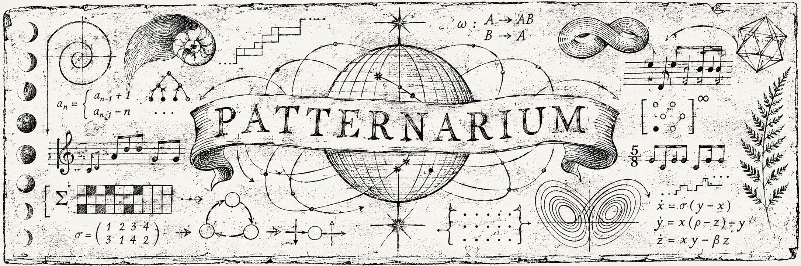

# Patternarium

By Fellipe Miranda Martins · [GitHub repository](https://github.com/fmiramar/Patternarium)

Language-side Patterns for stateful streams, mathematical sequences, and generative systems in SuperCollider. GPL-3.0-or-later; no runtime dependency beyond SuperCollider. Target: SuperCollider 3.14.x and compatible develop builds.

Implemented Patterns: `Pscan`, `Pwindow`, `Ptransduce`, `Pmorphism`, `PdeBruijn`, `PgrayCode`, `Pqmc`, `ProtationWord`, `PnumSeq`, `Prenewal`, `Phawkes`, `Pconstraint`, and `PgraphWalk`, with abstract base `PpointProcess`. This is an unreleased development snapshot. Local tests pass on SuperCollider 3.14.1; further validation is tracked in [implementation status](docs/implementation-status.md). All specified public classes now exist. Stabilization and release checks in [the specification](Patternarium_plan.md) remain pending.

The five **experimental** Patterns are `Pvomm`, `Ppetri`, `Pkuramoto`, `Pbranching`, and `Psandpile`. Their APIs may change before 1.0. They have deterministic tests and application examples alongside the other Patterns.

Install from GitHub:

```supercollider
Quarks.install("https://github.com/fmiramar/Patternarium");
thisProcess.recompile;
```

Or install a local checkout:

```supercollider
Quarks.install("/absolute/path/to/Patternarium");
thisProcess.recompile;
```

```supercollider
Pscan(Pseq([1, 2, 3]), 0, { |state, input| state + input }).asStream.all;
Pwindow(Pseries(0, 1, 6), 3).asStream.all;
Pqmc(2, length: 8).asStream.all;
PnumSeq(\norgard, length: 16).asStream.all;
Prenewal(Pseq([0.25, 0.5, 1]), output: \time).asStream.all;
Pmorphism([\a], (a: [\a, \b], b: [\a]), 4, \generations, true).asStream.all;
```

Open the Patternarium Guide in SuperCollider Help for the four example instruments and links to class documentation. Numerical operations need no audio server. SynthDefs occur only in Help/example code.

Run `scripts/test.sh` from a shell. It loads only the core class library, Patternarium classes, and Patternarium tests, without editing your extension installation or language configuration. Override `SCLANG` and `SC_CLASS_LIBRARY` for other installation locations. Linux CI runs the same command; its distribution package may differ from the target 3.14 release. Cross-platform target-version checks remain release gates.

Run `scripts/test.sh "$PWD/Tests/check-help.scd"` to parse and render all SCDoc files into the platform temporary directory. This also evaluates numerical blocks, builds the example SynthDefs without sending them, and generates Events from musical examples in place of playback. It does not test audio-device output.

Inside the IDE, `TestPscan.run` runs one class, and `UnitTest.runAll` includes these tests alongside other installed tests. `Tests/run.scd` runs only Patternarium tests and exits with failure on assertions, exceptions, or missing classes.

Author and repository URL metadata identify Fellipe Miranda Martins and https://github.com/fmiramar/Patternarium. No release is tagged or published by the implementation scripts.

Run `scripts/test.sh "$PWD/Tests/benchmarks.scd"` for small finite, server-free workloads. Results include collecting all outputs and are specific to the current machine; they are not a CI performance gate.

The numerical Help examples now have additional **sound companions**. First boot the server and load the four SynthDefs in the Patternarium Guide's “Example instruments” section, then evaluate a companion block. Each audition is finite (at most 64 output items); Cmd-period stops playback. The existing array-inspection examples are preserved. The standalone files in `examples/` also contain the appended auditions.
